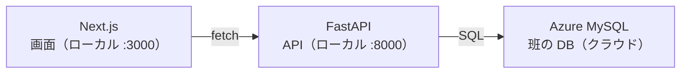

# ゆっくり旅行に行きたい

## プロジェクトの概要

ギフト専門 EC サービス「Giftia」の改修を提案するための、チーム「ゆっくり旅行に行きたい」のリポジトリ。

### 今回の改修

| 項目 | 内容 |
|---|---|
| 対象顧客 | 【要決定】<br>案1：決まった相手に毎年同じものを贈る人（Eさん）<br>案2：その都度探す人（Aさん） |
| 解く課題 | 【要決定】 |
| 作るもの | 【要決定】 |

### 関連資料

- [ケース資料](https://gregarious-sable-36c9eb.netlify.app/)
- 要求定義書：【要決定：リンク】
- 要件定義書：【要決定：リンク】

## チーム

| メンバー | 担当 |
|---|---|
| ジョー | 【要決定】 |
| おがけん | 【要決定】 |
| ひろ | 【要決定】 |

## システム構成

画面（Next.js）が API（FastAPI）を呼び、API が Azure 上の班の DB に SQL を投げます。Next.js と FastAPI はローカル、DB はクラウドで動きます。



システム構成 · 画面、API、DB の3層

## ディレクトリ構成

```text
.
├── giftia-frontend/   # 画面（Next.js）
├── backend/           # API（FastAPI）
├── AGENTS.md          # AI の使い方のルール
└── README.md
```

## 開発環境の構築

必要なもの：Node.js 20.9 以上、Python 3.10 以上、SourceTree、班の DB の接続情報

## 開発の進め方

GitHub Flow で進める。

AI と一緒に作ってもよいが、`main` に入れる判断と操作は人が行う。

1. 最新の `main` から作業ブランチを切る
2. AI と作ったコードを動かして確かめ、頼んでいない変更や `.env` がないかを見てから commit・push する
3. PR を出し、本文に「何を／なぜ／確認手順」を自分の言葉で書く
4. 本人以外が手元で動かして確認してから Approve・merge する
5. merge 後は全員が pull して起動し、PR に「再現 OK」とコメントする

PR は1つにつき目的を1つにします。`main` には直接 push しない。

コミットメッセージは `種類: 何をしたか` の形式で記載

## 班のルール

| 項目 | ルール |
|---|---|
| リーダー（`main` を置く人・ブランチ保護を設定する人） | 【要決定】 |
| ブランチの名前 | 【案】`feature/<内容>`（例：`feature/search`） |
| merge する人 | 【案】Approve した人 |
| レビューの最低ライン | 【案】差分を見る、本人以外が手元で動かす |
| `.env` の受け渡し | 【要決定】GitHub には載せない |
| リポジトリの公開範囲 | 【案】Private |
| AI の使い方 | AGENTS.md にまとめる |
